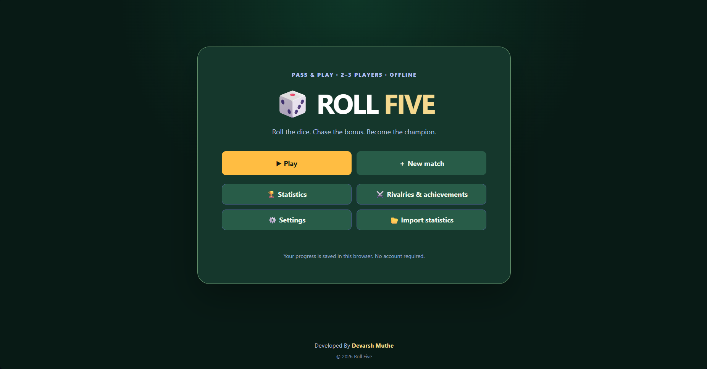
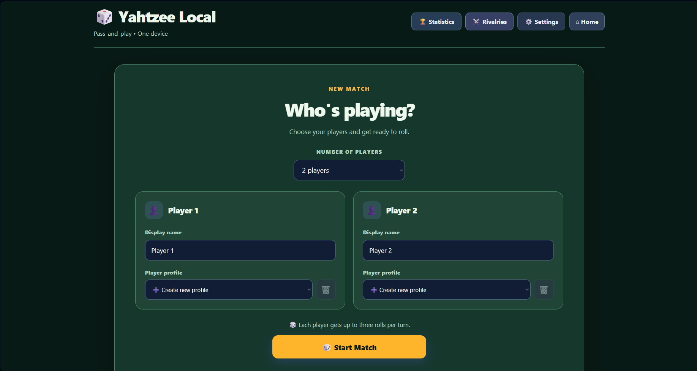
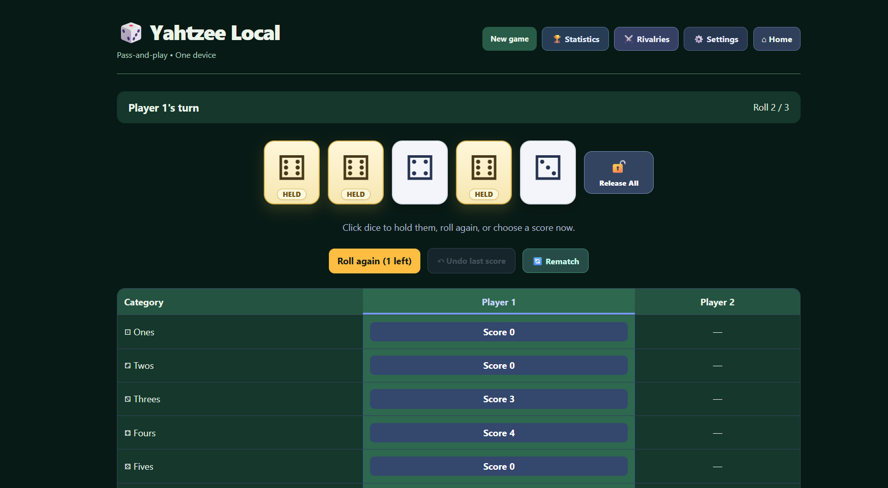
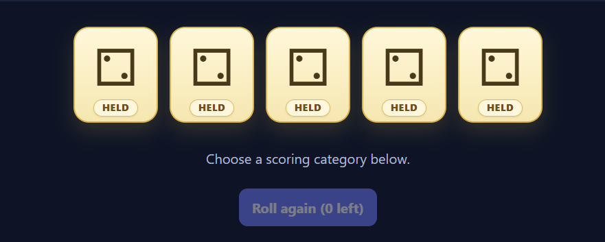
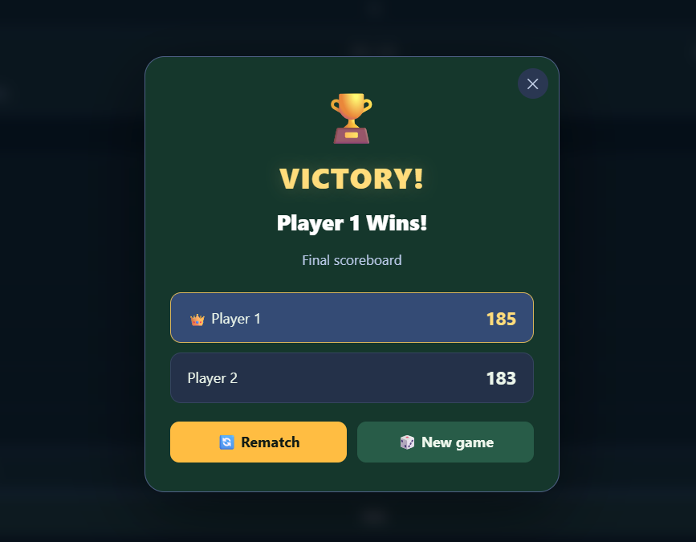
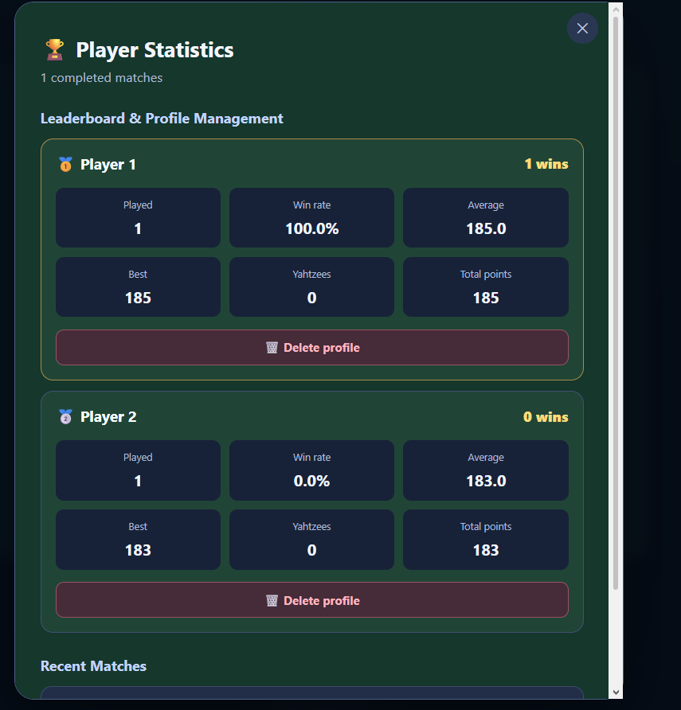
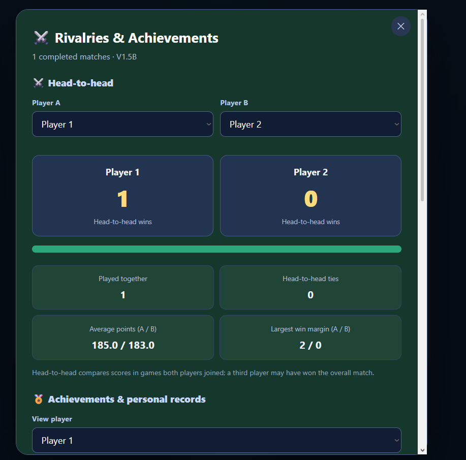
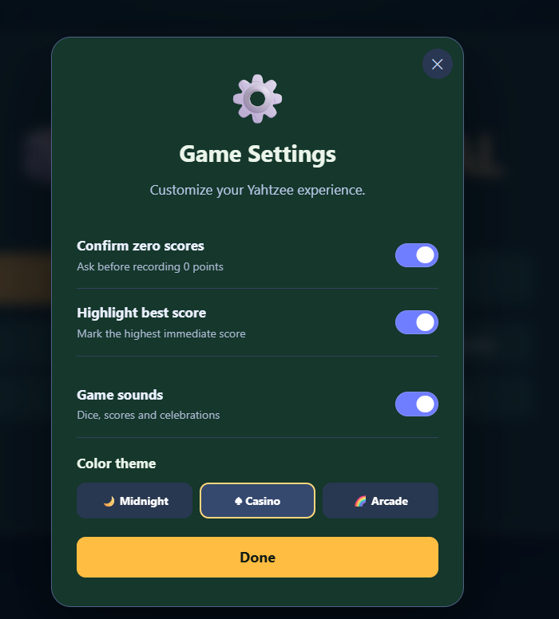

# 🎲 Roll Five

**A multiplayer, pass-and-play Yahtzee game built with HTML, CSS, and vanilla JavaScript.**

Play with **2 or 3 people on one device**. Roll animated dice, hold your favorites, fill in your scorecard, and compete for the highest total — with celebrations, persistent player statistics, and customizable themes.

**Created By Devarsh Muthe**

**Play online:**
(https://github.com/DESPITEOFIT/roll-five)

## 📸 Screenshots

### Home screen



| New match setup | Live gameplay |
| --- | --- |
|  |  |

| Five-of-a-kind celebration | Winner announcement |
| --- | --- |
|  |  |

| Player statistics | Rivalries and achievements |
| --- | --- |
|  |  |

<details>
<summary>Settings preview</summary>



</details>

## ✨ Features

### Gameplay

- **2–3 player local multiplayer** with one shared set of five dice and a side-by-side scorecard.
- **Up to three rolls per turn**, with the ability to hold and release individual dice.
- **Release All** button to unhold all five dice at once.
- **All 13 standard scoring categories**, with automatic score calculation.
- **Upper-section bonus**, extra Yahtzee bonuses, and Joker scoring rules.
- **Live score previews** and an optional highlight for the highest *immediate* available score.
- **Undo last score** before the next player starts rolling.
- **Rematch** with the same players or start a new game with a different lineup.
- **Automatic game saving** so an unfinished match can be resumed after a refresh.

### Visuals and sound

- Animated dice rolls and clearly marked held dice.
- Confetti for a five-of-a-kind roll and for the final winner.
- In-game confirmation dialogs and a winner popup showing final scores.
- Turn-transition announcements.
- Optional sound effects for rolling, holding, scoring, Yahtzee, and victory applause.
- Three themes: **Midnight**, **Casino**, and **Arcade**.

### Statistics and profiles

- Persistent player profiles and duplicate-name prevention.
- Player-profile deletion with a confirmation prompt; related recorded matches are also removed.
- Leaderboard, win rates, averages, personal bests, and match history.
- Head-to-head comparisons between any two players who have played together.
- Personal records and achievements.
- **JSON export and import** of player profiles and completed match statistics.

## 🎮 How to play

1. Open the game and select **Play** or **New match**.
2. Choose **2 or 3 players**. Select existing player profiles or enter names for new profiles.
3. On your turn, click **Roll dice** to roll all dice that aren't held.
4. Click a die to **hold** it. Click again to release it, or use **Release All**.
5. You can roll up to **three times** in a turn, or score earlier.
6. Click one **unused score category** to record the displayed score. Each category can only be filled once per player.
7. After every player fills all **13 categories**, the player with the highest grand total wins.

### Scoring categories

| Category | Points |
| --- | --- |
| Ones, Twos, Threes, Fours, Fives, Sixes | Sum of dice showing that face |
| Three of a kind | Sum of all five dice if at least three match; otherwise 0 |
| Four of a kind | Sum of all five dice if at least four match; otherwise 0 |
| Full house | 25 for three of one face and two of another |
| Small straight | 30 for at least four consecutive faces |
| Large straight | 40 for five consecutive faces |
| Yahtzee | 50 for five of a kind |
| Chance | Sum of all five dice |

**Upper bonus:** Score at least **63 points** across Ones through Sixes to earn **+35 points**.

**Extra Yahtzee bonus:** After you've already recorded **50** in the Yahtzee category, another five-of-a-kind can award **+100 points**, in addition to a score in another eligible category. Joker placement rules may restrict which category you can choose.

**Note:** The “Best” badge indicates the highest *immediate* available score, not necessarily the best long-term strategy. It can be turned off in Settings.

## 🚀 Run locally

No npm installation, database, or backend is required.

1. Clone or download this repository.
2. Open the `roll-five` folder in VS Code (or another editor).
3. Run `index.html` using a local server such as the **Live Server** VS Code extension.
4. Open the local address in your browser and play.

You can also open `index.html` directly, but using a local server is recommended for consistent browser storage behavior.

## 🗂️ Project structure

```text
roll-five/
├── index.html       # Page structure and script loading
├── style.css        # Layout, themes, animations, popups
├── game.js          # Dice mechanics, scoring, game state
├── stats.js         # Profiles, leaderboard, match history
├── stats-plus.js    # Rivalries, achievements, personal records
├── app-v1.6.js      # Home screen, audio, theme settings, import
├── screenshots/     # README images (add your own captures)
│   ├── home.png
│   ├── setup.png
│   ├── gameplay.png
│   ├── yahtzee.png
│   ├── winner.png
│   ├── statistics.png
│   ├── rivalries.png
│   └── settings.png
└── README.md
```

## 🛠️ Built with

- **HTML5** — page structure and accessible controls
- **CSS3** — responsive layouts, themes, animation, confetti
- **Vanilla JavaScript** — rules, DOM updates, turn management, profiles
- **Web Audio API** — synthesized sound effects
- **localStorage** — saved games, settings, profiles, and match records
- **GitHub Pages** — static website hosting

## 💾 Save data, backups, and privacy

- Game progress and statistics are saved **in the browser on the current device and site origin**.
- Players do **not** need accounts, and the game does not send scores to an online database.
- Stats are **not synchronized** between devices or between a local-server address and a GitHub Pages address.
- Use **Export statistics** to download a JSON backup, and **Import statistics** to restore it on another browser or site origin.
- **Import replaces existing profiles and match history** and clears the current saved game. Export first if you want to keep the existing data.
- Deleting a player profile can also remove completed match records involving that profile, affecting other players' statistics.
- Clearing browser site data removes locally stored progress and statistics unless they were backed up.

> This is **local pass-and-play multiplayer**, not online real-time multiplayer. A locally downloaded copy can run without an internet connection; the hosted GitHub Pages version needs to load from the website.

GitHub Pages documentation: https://docs.github.com/en/pages/getting-started-with-github-pages/configuring-a-publishing-source-for-your-github-pages-site

## 👨‍💻 Author

**Devarsh Muthe**


---

**Yahtzee Local — Final release: v1.6.4**
